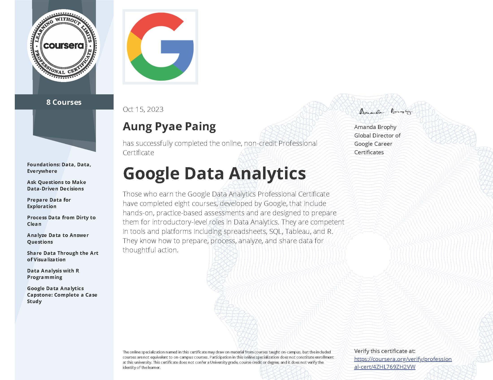
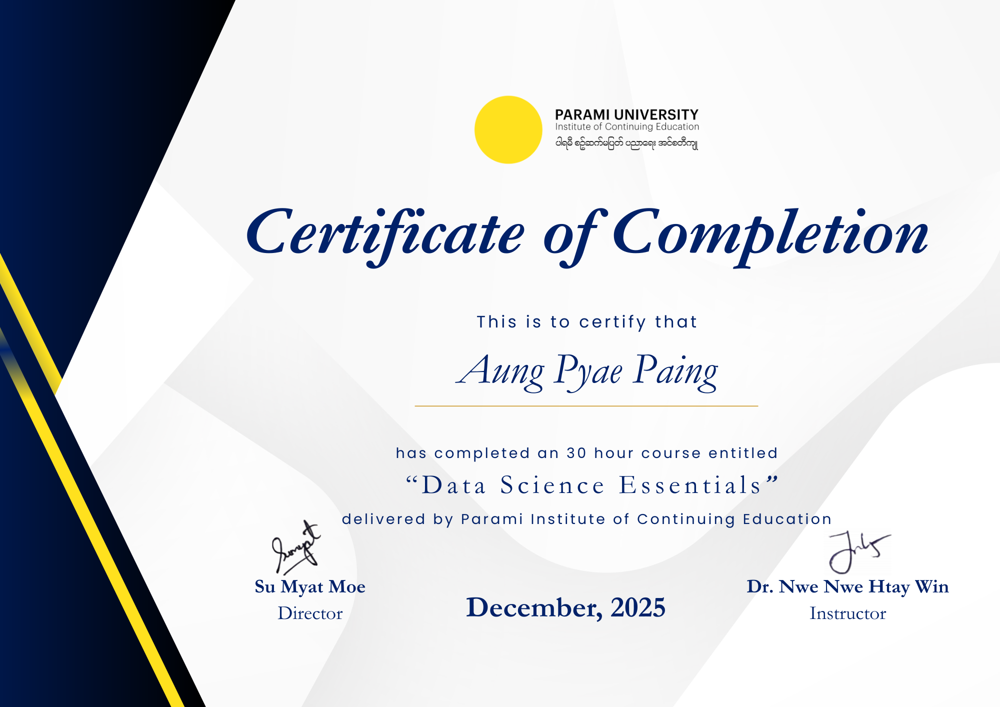
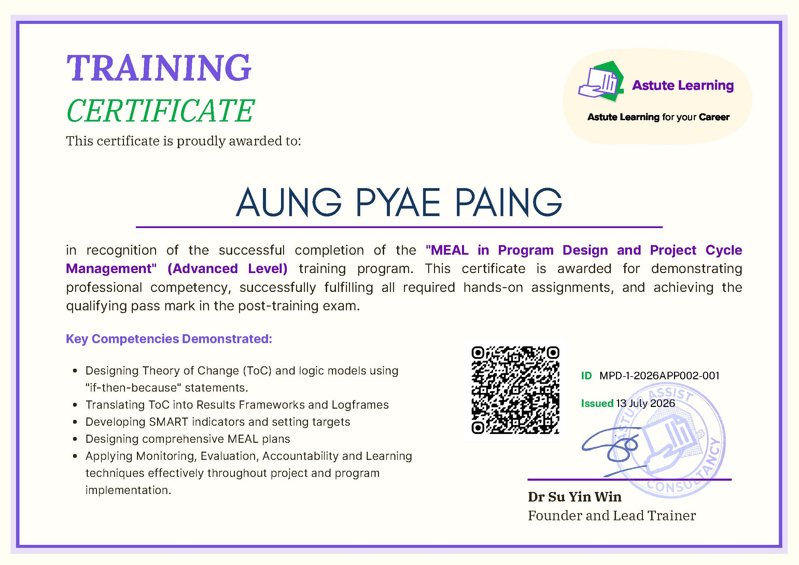

This page highlights my professional training and the key skills I have developed through each course.

## Google Data Analytics

**Issuing Organization:** Coursera

**Date Obtained:** October, 2023

**Key Learning Areas:**

- Data processing, analysis, and visualization using Excel, SQL, R, and Tableau

------------------------------------------------------------------------

## Data Science Essentials

**Issuing Organization:** [Parami University](https://www.parami.edu.mm/){target="_blank"}

**Date Obtained:** December, 2025

**Key Learning Areas:**

- Data processing, analysis and visualization using Python

------------------------------------------------------------------------

## MEAL in Program Design and Project Cycle Management (Advanced Level)

**Issuing Organization:** [Astute Learning](https://www.astuteassist.com/home)

**Date Obtained:** July, 2026

**Key Learning Areas:**

- Designing Theory of Change (ToC) and logic models using if‑then‑because statements.
- Translating ToC into Results Frameworks and Logframes.
- Developing SMART indicators and setting targets.
- Designing comprehensive MEAL plans.
- Applying Monitoring, Evaluation, Accountability and Learning techniques effectively throughout project and program implementation.
